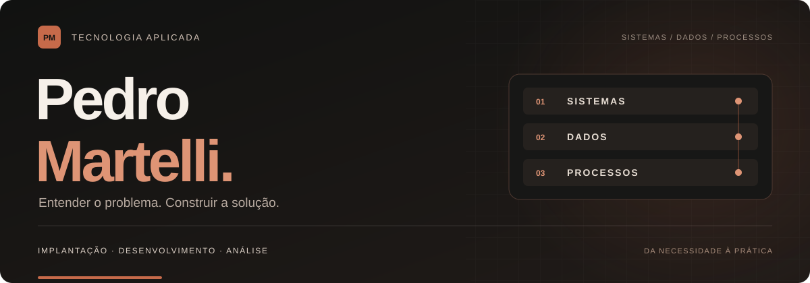

<!-- Pedro Martelli · README de perfil · Grafite + Terracota -->

  

### Analista de Implantação de Sistemas Nível 1

Experiência com sistemas e processos. Projetos em desenvolvimento e dados.

  
  
  

[Sobre](#sobre) &nbsp; / &nbsp; [Projetos](#projetos) &nbsp; / &nbsp; [Tecnologias](#tecnologias) &nbsp; / &nbsp; [Formação](#formação) &nbsp; / &nbsp; [Contato](#contato)

 

## Sobre

Sou **Pedro Martelli**, formado em **Análise e Desenvolvimento de Sistemas pela UNIP**. Trabalho com implantação, configuração e suporte a sistemas, acompanhando de perto as necessidades de quem depende da tecnologia para trabalhar.

Essa experiência me ensinou a investigar falhas, entender processos e traduzir dúvidas em ações concretas. Levo essa base para meus projetos de **desenvolvimento de software e análise de dados**, conectando a lógica do código à rotina de uso.

Atualmente, curso pós-graduações em **Gestão de TI** e **Gerenciamento de Projetos de TI**, ampliando minha visão sobre planejamento, organização e entrega de soluções.

> **Meu ponto de partida é o problema. A tecnologia vem para resolvê-lo.**

 

## Projetos

Aplicações que aproximam meu conhecimento técnico de situações reais.

<table>
  <tr>
    <td width="50%" valign="top">
      
      <h3>Portfólio Profissional</h3>
      
Uma aplicação web para apresentar minha trajetória, projetos e conteúdos sobre tecnologia.

      
<strong>O que exploro:</strong> organização de conteúdo, identidade visual, interfaces e responsividade.

      
<code>HTML</code> <code>CSS</code> <code>JavaScript</code>

      

        <a href="https://pedromartellitech.github.io/pedro-martelli/"><strong>Ver online ↗</strong></a>
        &nbsp;·&nbsp;
        <a href="https://github.com/pedromartellitech/pedro-martelli">Código-fonte</a>
      

    </td>
    <td width="50%" valign="top">
      
      <h3>Sistema de Vendas</h3>
      
Uma aplicação para organizar vendas, produtos, estoque e informações financeiras de uma loja de variedades.

      
<strong>O que exploro:</strong> persistência em banco de dados, regras da operação e relatórios interativos.

      
<code>Python</code> <code>Streamlit</code> <code>SQLite</code>

      

        <a href="https://github.com/pedromartellitech/Sistema-de-Vendas"><strong>Explorar projeto ↗</strong></a>
      

    </td>
  </tr>
</table>

<strong>Outras iniciativas e estudos</strong>

 

| Iniciativa | Proposta | Tecnologias |
| :--- | :--- | :--- |
| **Finance OS** | Projeto pessoal de gestão financeira, com lançamentos, organização de contas e indicadores. | Python · Streamlit · SQLite |
| [**Scripts em Python**](https://github.com/pedromartellitech/python-scripts) | Coleção de scripts e estudos de programação. | Python |
| [**Estudos em C#**](https://github.com/pedromartellitech/scripts-csharp) | Repositório dedicado a scripts e estudos da linguagem. | C# |

 

## Tecnologias

Ferramentas presentes no meu trabalho, na minha formação e nos meus projetos.

| Frente | Tecnologias e ferramentas |
| :--- | :--- |
| **Desenvolvimento** | Python · C# · HTML · CSS · JavaScript |
| **Dados e aplicações** | SQL · SQLite · MySQL · Pandas · NumPy · Streamlit |
| **Análise e visualização** | Power BI · Excel |
| **Código e colaboração** | Git · GitHub · VS Code · Visual Studio · Postman |
| **Organização de atividades** | Jira · Monday |

<strong>Como conecto essas frentes</strong>

 

- **Sistemas:** implantação, configuração, investigação de problemas e orientação sobre o uso das soluções.
- **Desenvolvimento:** aplicações web e projetos em Python para praticar programação e resolver necessidades específicas.
- **Dados:** organização de informações, consultas, tratamento e construção de indicadores.
- **Processos e projetos:** estudo de planejamento, requisitos, acompanhamento de entregas e governança de TI.

 

## Formação

| Formação | Instituição / situação |
| :--- | :--- |
| **Análise e Desenvolvimento de Sistemas** | Universidade Paulista — UNIP · Concluída |
| **Pós-graduação em Gestão de TI** | Em andamento |
| **Pós-graduação em Gerenciamento de Projetos de TI** | Em andamento |

**Direções de estudo:** desenvolvimento de software, arquitetura, análise de dados, inteligência artificial e governança de TI.

 

## Como trabalho

1. **Entender o contexto.** Investigar a necessidade, os usuários e o processo envolvido.
2. **Estruturar a solução.** Definir requisitos, organizar informações e escolher uma abordagem compatível com o problema.
3. **Construir e validar.** Desenvolver ou configurar a solução e verificar seu funcionamento na prática.
4. **Acompanhar e evoluir.** Documentar aprendizados, observar dificuldades e ajustar o que for necessário.

 

---

## Contato

**Vamos conversar sobre o próximo projeto?**

Tenho interesse em oportunidades em **implantação de sistemas, desenvolvimento e dados**.

[Portfólio](https://pedromartellitech.github.io/pedro-martelli/) &nbsp; / &nbsp; [LinkedIn](https://www.linkedin.com/in/pedro-martelli/) &nbsp; / &nbsp; [pedromartelli156@gmail.com](mailto:pedromartelli156@gmail.com)

 

